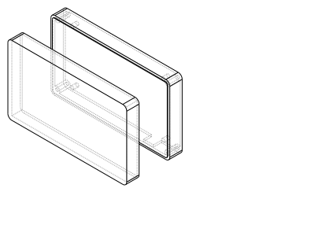

# ShadowComms — Off-Grid LoRa Communicator

Handheld encrypted text messenger over LoRa radio — no cell network, no Wi-Fi, no internet. Built from scratch for Hack Club Half Life.



## What it is

A pocket-size device that lets two people exchange AES-encrypted text messages over 868 MHz LoRa radio, completely off the grid. Designed for field use: sunlight-readable E-Paper display, physical keyboard, and a LiPo battery with USB-C charging.

## How it works

| Block | Part | Role |
|---|---|---|
| MCU | ESP32-WROOM-32E | Runs the mesh, AES-128 crypto, display driver |
| Radio | SX1262 module | 868 MHz LoRa transceiver, +22 dBm |
| Display | 2.9" E-Paper (Waveshare) | Sunlight readable, ~zero idle power |
| Input | Mini QWERTY membrane | Text entry through 3 window slots |
| Power | LiPo 803048 + TP4056 | Charge over USB-C, ~week of standby |
| Antenna | SMA edge | Snap-in bushing for a whip antenna |

```
   [QWERTY]──┐                          ┌──[SMA ANT]
             │                          │
   [E-Paper]─┼── ESP32 ── SPI ── SX1262─┘
             │     │
   [Piezo]───┘   [TP4056]──[LiPo]──[USB-C]
```

## Enclosure (Week 2 — CAD)

Both halves are parametric CAD; the source of truth is `cad/build_enclosure.py`. Regenerate everything with:

```bash
E:/shadowcomms_venv/Scripts/python cad/build_enclosure.py
```

The script emits `STEP` (editable source), `STL` (printable), and an isometric SVG of each part plus the assembly, into `cad/exports/`.

**Key dimensions**

| Feature | Size |
|---|---|
| Outside envelope | 120 × 70 × 25 mm |
| Wall thickness | 2.0 mm |
| E-Paper window | 67.4 × 30.6 mm (module + 0.3 clearance) |
| SMA orifice | Ø6.4 mm, left face |
| USB-C slot | 10 × 8 mm, front face |
| QWERTY slots | 3 × (18 × 20 mm) spaced 2 mm |
| Screw pattern | 4 × M2.5, 112 × 62 mm spacing |

### Opening the model in Onshape

1. Sign in at [onshape.com](https://www.onshape.com) (free public plan works).
2. Click **Create → Import files** in the Documents list.
3. Upload `cad/exports/shell_top.step` and `cad/exports/shell_bottom.step` (Onshape turns each STEP into a Part Studio automatically, so every feature history point stays editable).
4. Repeat for `shadowcomms_assembly.step` if you want the parts pre-placed.

## Repository layout

```
cad/
  build_enclosure.py    # parametric source (CadQuery)
  exports/              # STEP + STL + SVG views
BOM.md                  # mirrored from Half Life
JOURNAL.md              # mirrored from Half Life
```

## Bill of materials

See [BOM.md](BOM.md) for the platform-tracked parts list (funded tier).

## License

MIT
